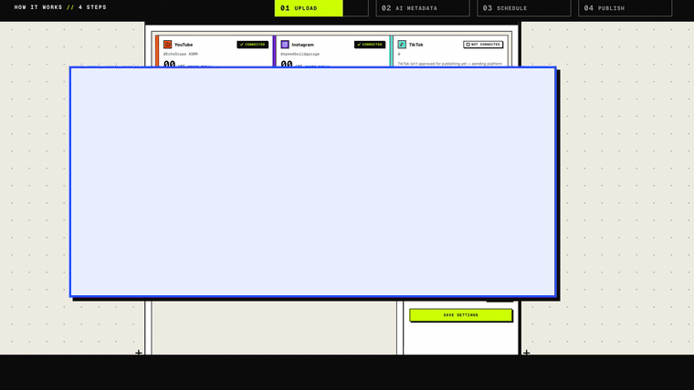

<div align="center">

# Content Automation

**Autopilot for short-form video.** Drop in a batch of videos once — AI writes the title, description and hashtags, a scheduler picks real peak hours in your audience's timezone, and posts go out to YouTube and Instagram on their own.

[](LICENSE)




▶ **[Download the full 58-second intro video (with voice-over, 29 MB)](https://github.com/Abdull121/Ai-Content-Automation/raw/main/docs/media/content-automation-intro.mp4)** — built entirely from code, see [`promo-video/`](promo-video).

</div>

---

## The problem

Making short-form videos in batches is fine. *Posting* them is the slow part:

- writing a title, description and hashtags for every clip
- working out when your audience is actually online — especially when you live in a different timezone
- uploading to each platform, one video at a time, without tripping daily limits

This project removes all of it. You drop the files; everything else runs itself.

## Features

| | |
|---|---|
| 🎬 **Bulk upload** | Drop 50+ videos at once and choose target platforms. |
| 🤖 **AI metadata** | [Whisper](https://console.groq.com/docs/speech-to-text) transcribes each video's audio, then an LLM writes a title, description and hashtags. |
| 🕒 **Peak-hour scheduling** | Posts are placed on engagement peaks in the **target audience's** timezone, spread across a posting window with natural jitter — never bursts. |
| 🛡️ **Daily caps per platform** | Configurable per-platform limits keep accounts healthy; overflow rolls to the next day automatically. |
| ☁️ **Always on** | A 5-minute publish loop posts due videos and frees storage once a video is live. |
| 🔌 **OAuth connect** | Connect YouTube and Instagram from the dashboard — no tokens to paste. |

**Platform status:** YouTube ✅ · Instagram ✅ · TikTok ⏳ (UI and schema are ready; publishing waits on TikTok's Content Posting API audit — contributions welcome).

## How it works

```
  Browser ──upload──▶ Next.js API ──▶ Appwrite Storage
                          │
                          ▼
              Groq Whisper  ──▶  Groq LLM        title · description · hashtags
                          │
                          ▼
         assign slot (peak hours · window · daily cap)   ──▶  Appwrite TablesDB
                          │
        every 5 min       ▼
        publish cycle ──▶ YouTube Data API / Instagram Graph API ──▶ cleanup storage
```

## Tech stack

- **Frontend / API:** Next.js 16 (App Router), React 19, TypeScript, Tailwind CSS 4
- **Data & files:** [Appwrite](https://appwrite.io) (TablesDB + Storage; Cloud or self-hosted)
- **AI:** [Groq](https://groq.com) — `whisper-large-v3-turbo` for transcription, `openai/gpt-oss-120b` for metadata
- **Publishing:** YouTube Data API v3, Instagram API with Instagram Login

## Project structure

```
frontend/           Next.js app — clean architecture
  src/domain/         entities, repository interfaces, scheduling policies (no dependencies)
  src/application/    use cases
  src/infrastructure/ Appwrite repositories, Groq client, YouTube/Instagram publishers, publish engine
  src/presentation/   dashboard UI components
  src/app/api/        route handlers (videos, schedule, accounts, OAuth, publish)
backend/scripts/    one-off Appwrite setup (create tables + indexes, seed default config)
promo-video/        the intro video — HTML/CSS/JS timeline rendered frame-by-frame, no video AI
docs/media/         intro video + poster
```

## Getting started

### Prerequisites

- Node.js 20+
- An [Appwrite](https://cloud.appwrite.io) project (free tier is enough)
- A [Groq](https://console.groq.com) API key (free tier is enough)
- For publishing: a Google Cloud OAuth client (YouTube) and/or a Meta developer app (Instagram)
- [mkcert](https://github.com/FiloSottile/mkcert) — Google and Instagram OAuth want HTTPS redirect URIs, even locally

### 1 · Appwrite

1. Create a project, a **Database**, and a **Storage bucket**.
2. Create an **API key** with these scopes: `databases.read/write`, `tables.read/write`, `columns.read/write`, `indexes.read/write`, `rows.read/write`, `files.read/write`.
3. Give the bucket **public read** access (role `any`, permission *Read*). Instagram fetches the video from a public URL, so it must be reachable. Files are deleted automatically after publishing.

### 2 · Configure and create the schema

```bash
cd backend
cp .env.example .env          # fill in the Appwrite values (+ GROQ_API_KEY if you like)
npm install
node scripts/setup-database.mjs   # creates tables, columns and indexes
node scripts/seed.mjs             # inserts the default schedule config
```

### 3 · Run the app

```bash
cd frontend
cp .env.example .env.local    # fill in every value
npm install

mkdir .certs && cd .certs
mkcert -install && mkcert -key-file localhost-key.pem -cert-file localhost-cert.pem localhost
cd ..

npm run dev                   # https://localhost:3000  (use `npm run dev:http` if you don't need OAuth)
```

Open <https://localhost:3000>, connect your accounts, and drop in some videos.

### OAuth setup

<details>
<summary><b>YouTube</b></summary>

1. [Google Cloud Console](https://console.cloud.google.com) → enable **YouTube Data API v3**.
2. Credentials → **OAuth client ID** → type *Web application*. Add `https://localhost:3000/api/auth/youtube/callback` as an authorised redirect URI.
3. Put the client id/secret in `.env.local`. While the OAuth consent screen is in *Testing*, add yourself as a test user.
4. Note: unverified API projects upload as **private** until the project passes YouTube's API audit, and quota is ~6 uploads/day by default.
</details>

<details>
<summary><b>Instagram</b></summary>

1. [Meta for Developers](https://developers.facebook.com) → create an app and add **Instagram API with Instagram Login**.
2. Add `https://localhost:3000/api/auth/instagram/callback` as a valid OAuth redirect URI.
3. Use an Instagram **Business/Creator** account. While the app is in development mode, add your account under *Roles → Instagram Testers* and accept the invite.
4. Reels are limited by Instagram (~100 API-published posts per 24 h); the default cap in this app is far below that.
</details>

## Scheduling and publishing

- The posting window, timezone and per-platform caps are edited in the **Schedule** panel.
- `frontend/src/instrumentation.ts` starts an in-process loop (every 5 minutes) when the Next.js Node server boots. Use this when you self-host on a long-running server.
- On serverless hosting there is no long-running process, so trigger the cycle from any scheduler instead:

  ```bash
  curl -X POST https://your-app.example.com/api/publish/run \
       -H "Authorization: Bearer $CRON_SECRET"
  ```

  Set `CRON_SECRET` in the environment to require that header. (Appwrite Functions, GitHub Actions cron or cron-job.org all work.)
- Uploads go through the Next.js route handler, so your host's request body limit applies (self-host or raise the limit for large files).

## ⚠️ Security notes

This is a **single-tenant** tool: there is **no user authentication** in the app. Anyone who can reach the URL can see the dashboard, upload, delete and trigger publishing. Before putting it on the public internet, put it behind something — a reverse-proxy password, Cloudflare Access, Netlify password protection, or add your own auth — and set `CRON_SECRET`. See [SECURITY.md](SECURITY.md).

Never commit `.env*` files, `client_secret*.json` or token files — they are in `.gitignore`.

## The intro video

[`promo-video/`](promo-video) contains the source of the intro film above. No video-generation AI or editor was used: it is a seekable HTML/CSS/JS timeline (Web Animations API) captured frame-by-frame with headless Chromium, with a procedurally synthesised soundtrack and a [Gemini TTS](https://ai.google.dev/gemini-api/docs/speech-generation) voice-over, muxed with ffmpeg.

```bash
cd promo-video && npm install
node audio.mjs                 # synthesise the soundtrack  → audio.wav
node render.mjs full 4         # render 1740 frames with 4 workers → frames/
# optional voice-over (needs GEMINI_API_KEY in promo-video/.env): node vo-batch.mjs && node vo-mix.mjs
ffmpeg -framerate 30 -i frames/f%05d.jpg -i audio-vo.wav -c:v libx264 -crf 16 -pix_fmt yuv420p -c:a aac out/intro.mp4
```

Requires ffmpeg and a Chromium-based browser (set the path in `render.mjs`). The Geist fonts are © Vercel, licensed under the SIL OFL.

## Contributing

Contributions are very welcome — see [CONTRIBUTING.md](CONTRIBUTING.md). Good first areas: TikTok publishing, authentication, per-account (multi-tenant) support, tests, and more platforms (Shorts/Reels are done — Facebook, X, LinkedIn video?).

## License

[MIT](LICENSE)
